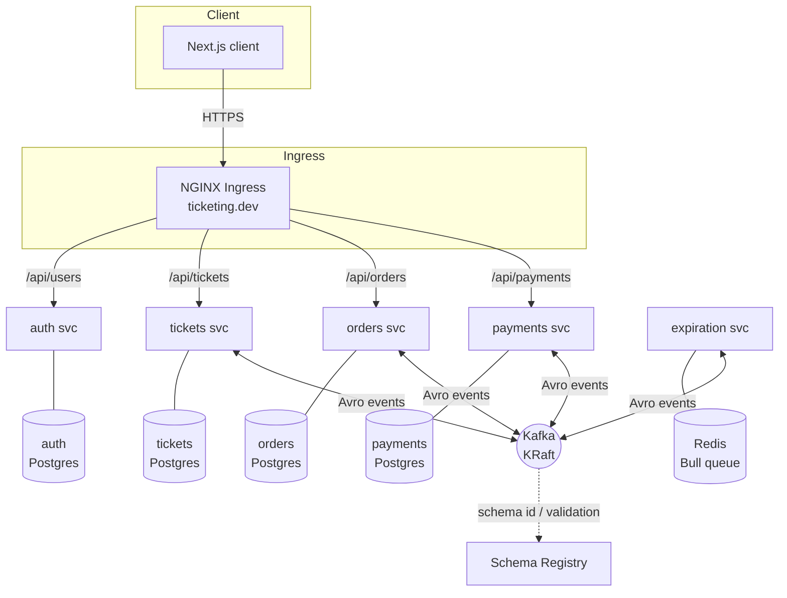

# Architecture Overview

The big-picture view of the ticketing system: the services, how they talk, and the
data + event flow. Read this first, then the [ADRs](../adr/) for the *why*.

## Domain in one paragraph

Users sign up and list **tickets** for events. Another user places an **order** to
buy a ticket, which reserves it for a fixed window. If the buyer **pays** (Stripe)
before the window closes, the order completes; if the window **expires** first, the
order is cancelled and the ticket is released. That reserve → (pay | expire) flow is
a **choreographed saga** — see [`saga.md`](saga.md).

## Topology

Notes:
- **Synchronous** traffic (browser → service) is REST through the ingress. Services
  do **not** call each other synchronously — all inter-service communication is
  asynchronous over Kafka. This is a core microservices property: no request-time
  coupling between services.
- Each stateful service owns a **private Postgres** ([ADR-0003](../adr/0003-postgres-per-service.md)).
- `expiration` uses **Redis + Bull** for *delayed jobs*, not as an event store —
  Kafka has no native delayed delivery, so a delay queue is the right tool. Its
  event edges still go through Kafka.

## Events (the async contracts)

Topic names are the `subject` strings; each has an Avro schema in the registry
([ADR-0002](../adr/0002-avro-schema-registry.md)).

| Topic | Produced by | Consumed by | Meaning |
| ----- | ----------- | ----------- | ------- |
| `ticket:created`     | tickets    | orders                 | A new ticket exists (orders keeps a local replica). |
| `ticket:updated`     | tickets    | orders                 | A ticket changed (price/title) or was reserved. |
| `order:created`      | orders     | tickets, expiration, payments | An order reserved a ticket; starts the saga. |
| `order:cancelled`    | orders     | tickets, payments      | An order was cancelled (expired or by user). |
| `expiration:complete`| expiration | orders                 | The reservation window elapsed. |
| `payment:created`    | payments   | orders                 | Payment succeeded for an order. |

Each consumer group corresponds to a service; replicas of a service share a group
so a given event is handled once per interested service (competing consumers).

## The data-replication pattern

`orders` keeps a **local copy of tickets** (only the fields it needs: id, title,
price, version). It is populated by consuming `ticket:created` / `ticket:updated`.
This is deliberate: `orders` must decide "is this ticket reservable?" *without* a
synchronous call to `tickets`. It trades storage + eventual consistency for
**availability and decoupling** — `orders` keeps working even if `tickets` is down.
The `version` field keeps the replica consistent under out-of-order delivery; see
[`../concepts/optimistic-concurrency.md`](../concepts/optimistic-concurrency.md).

## Cross-cutting concerns

- **Auth:** JWT in a cookie, verified locally in each service
  ([ADR-0005](../adr/0005-keep-jwt-auth.md)).
- **Ordering & delivery:** per-entity ordering via Kafka message keys; at-least-once
  with manual offset commit ([`../concepts/kafka-kraft.md`](../concepts/kafka-kraft.md)).
- **Concurrency:** optimistic, via a `version` column
  ([`../concepts/optimistic-concurrency.md`](../concepts/optimistic-concurrency.md)).
