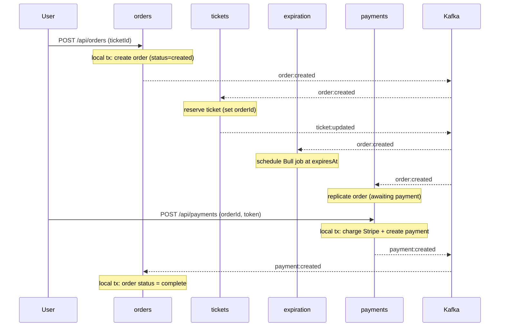
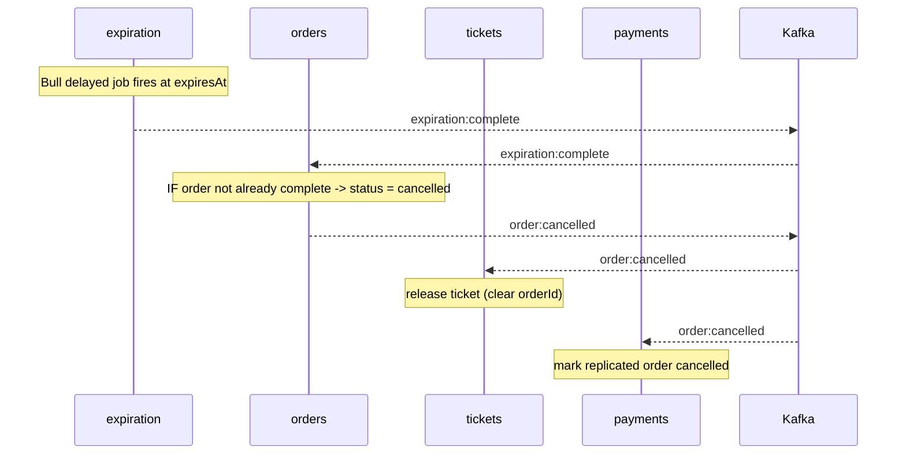

# The Purchase Saga

The order → payment → completion (or expiration → cancellation) flow is a
**choreographed saga**. Grider builds it but never names it; this document makes
the pattern explicit in Sam Newman's terms, because it is the most important
distributed-systems concept in the project.

## Why a saga at all

A user buying a ticket spans **four services** — orders, tickets, expiration,
payments — each owning its own database ([ADR-0003](../adr/0003-postgres-per-service.md)).
There is no shared transaction that can atomically "reserve the ticket, hold it
for 15 minutes, take payment, complete the order." A distributed ACID transaction
(2PC) across services is exactly what microservices avoid — it couples services
at runtime and creates a shared failure point.

Newman's answer is the **saga**: model the long-running business process as a
sequence of **local** transactions, each in one service, coordinated by events.
When something can't complete, you don't roll back (you can't — each local
transaction already committed); instead you run a **compensating action** that
semantically undoes the earlier step.

## Choreography vs orchestration

Newman describes two ways to coordinate a saga:

- **Orchestration** — a central coordinator tells each service what to do next.
  Explicit and easy to follow, but the orchestrator becomes a smart hub the
  services depend on.
- **Choreography** — no central brain. Each service reacts to events and emits
  its own, and the overall flow **emerges** from those reactions. More decoupled,
  but the flow isn't written down in any one place — which is precisely why this
  document exists.

**This project uses choreography.** Each service subscribes to the events it
cares about and publishes the events that result. No service "runs the saga";
the saga is the sum of their reactions over Kafka.

## The happy path (order → pay → complete)



Each `Note over` is a **local transaction** in one service's own Postgres. The
arrows over Kafka are the choreography — no central coordinator.

## The compensating path (expiration → cancel)

If payment does **not** arrive before `expiresAt`, the saga compensates:



**`order:cancelled` is the compensating action.** It semantically undoes
`order:created`: the ticket is released and any future payment attempt is
rejected. Note there is no literal rollback — the order row still exists, now in
`cancelled` state.

## The critical race: "don't cancel a paid order"

This is the `482-dont-cancel` course chapter and the saga's subtlest point. Two
events can arrive at `orders` near-simultaneously:

- `payment:created` (user paid just in time) → wants status **complete**
- `expiration:complete` (timer fired) → wants status **cancelled**

The rule: **a paid order must never be cancelled.** The `ExpirationCompleteListener`
enforces it by checking status before compensating:

```
if (order.status === 'complete') return msg.ack();  // do nothing
```

So if payment won the race and completed the order, the expiration event is
acknowledged and ignored. If expiration won, the order cancels and a later
payment is rejected (the payments route refuses a `cancelled` order). Either way
the outcome is consistent. See
`orders/src/events/listeners/expiration-complete-listener.ts`.

## What makes it safe

- **Local transactions only.** Every state change is a single-service DB commit;
  no cross-service transaction exists.
- **At-least-once + idempotency.** Kafka may redeliver; handlers are idempotent
  via the `version`-guarded writes ([optimistic-concurrency.md](../concepts/optimistic-concurrency.md)),
  so a duplicate event is a no-op.
- **Ordering where it matters.** Events about one aggregate are keyed by its id,
  so per-order and per-ticket event order is preserved
  ([kafka-kraft.md](../concepts/kafka-kraft.md)).
- **The compensating action is explicit** (`order:cancelled`), not an attempted
  rollback.

## Saga state — where does it live?

There is no saga table. The saga's state is the **order's `status`** in the
orders service (`created` → `awaiting:payment`/`complete`/`cancelled`), advanced
by the events each service emits. In choreography, the initiating aggregate's
state doubles as the saga's state — which is why `orders` is the natural home of
the "don't cancel a paid order" rule.

## Newman's framing, in one line

> A saga trades atomicity for availability: instead of one distributed
> transaction that can't scale, a chain of local transactions coordinated by
> events, with explicit compensation for the unhappy path. Choreography keeps the
> services decoupled at the cost of the flow being implicit — so we document it here.
