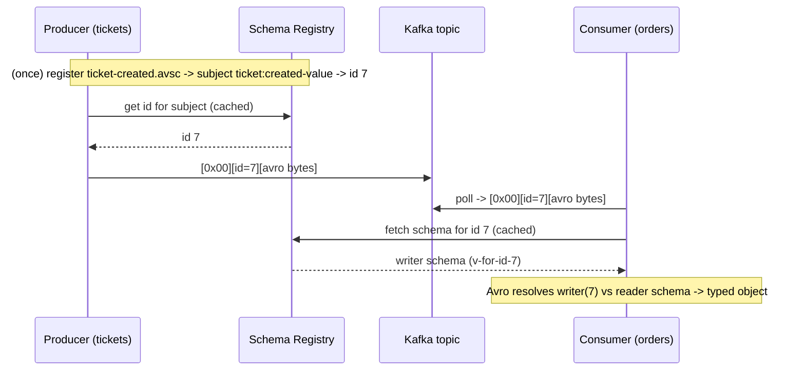

# Concept: Avro & the Schema Registry

How events are serialized and how their contracts are governed in this system.
This replaces Grider's "shared TypeScript interface + `JSON.stringify`" approach
([ADR-0002](../adr/0002-avro-schema-registry.md)).

> **Why this matters.** In a microservices system the event is the API between
> services. If that API is just an ad-hoc JSON blob whose shape lives in a shared
> code type, producer and consumer are welded together at compile time and nothing
> stops a breaking change from shipping. Avro + a registry turn the event into a
> *governed, versioned contract* that lets services evolve independently — the
> whole point of the architecture.

---

## 1. What Avro is

**Apache Avro** is a binary serialization format that is *schema-driven*: you
cannot read or write Avro data without its schema. A schema (`.avsc`) is JSON
describing a record — its fields, their types, defaults, and docs. Example
(trimmed):

```json
{
  "type": "record",
  "name": "TicketCreated",
  "namespace": "ticketing.tickets",
  "fields": [
    { "name": "id", "type": "string" },
    { "name": "version", "type": "int" },
    { "name": "price", "type": "double" }
  ]
}
```

Because the schema is separate from the data, the encoded bytes carry **no field
names or type tags** — just the values, in field order. That's why Avro is compact:
in this project a full `order:created` event is ~44 bytes in Avro vs. ~150+ as
JSON. The reader reconstructs field names/types from the schema.

### Avro types we use here

| Avro type            | Used for                    | Note |
| -------------------- | --------------------------- | ---- |
| `string`             | ids, titles, ISO timestamps | UTF-8 |
| `int`                | `version`                   | 32-bit; ample for a version counter |
| `double`             | `price`                     | mirrors JS number; see money note below |
| `["null", "string"]` | optional `orderId`          | a **union**; nullable = union with `null` + `default: null` |
| `enum`               | `OrderStatus`               | fixed symbol set; symbols must match `[A-Za-z_]\w*` (no `:` — hence `awaiting_payment`) |
| nested `record`      | the `ticket` inside an order| records compose |

---

## 2. Schema evolution & the tolerant reader

The reason to use Avro over "just JSON" is **safe evolution**. Avro deserialization
takes **two** schemas:

- the **writer's schema** — what the producer used when it encoded the bytes, and
- the **reader's schema** — what the consumer expects.

Avro **resolves** the two: it matches fields by name, fills in the reader's
defaults for fields the writer didn't have, and ignores fields the reader doesn't
know about. This is Newman's **tolerant reader** pattern — implemented by the
framework instead of by hand-written defensive parsing.

Concretely, that means you can:

- **Add a field** with a default → old writers' data still reads (reader supplies
  the default). *Backward compatible.*
- **Remove a field** that had a default → new readers ignore it in old data.
- **Rename/retype a field** → **not** compatible; the registry will reject it.

### Compatibility modes

A registry subject has a **compatibility mode** that defines which changes are
allowed. We use **`BACKWARD`**: *a new schema can read data written with the
previous schema.* Operationally this means **upgrade consumers before producers** —
the new consumer understands both old and new data, so it keeps working while
producers are still emitting the old shape. `BACKWARD` is the sane default for
event streams and is what this project sets (globally on the registry, plus
best-effort per subject in `schemas/src/register.ts`).

Other modes exist (`FORWARD`, `FULL`, `NONE`) — `BACKWARD` is chosen because in
our topology consumers are the ones that must not break when a producer's schema
advances.

---

## 3. The Schema Registry

The **Confluent Schema Registry** is a small service that stores schemas and
assigns each a global **schema id**. It also enforces the compatibility mode:
registering an incompatible new version is **rejected** at registration time — the
contract is checked *before* any bad data can flow.

### Subjects

Schemas are grouped under a **subject**. With the default **TopicNameStrategy**,
a topic's value schema is stored under subject `<topic>-value`. So our topic
`ticket:created` → subject `ticket:created-value`. Each subject has its own
version history and compatibility setting.

### The Confluent wire format

When a producer serializes a message, the bytes on the Kafka topic are **not** raw
Avro. They are framed:

```
byte 0        : magic byte (0x00)
bytes 1..4    : schema id (big-endian int32)  <- which schema wrote this
bytes 5..end  : the Avro-encoded payload
```

The consumer reads the 5-byte header, fetches that schema id from the registry
(cached after first use), and uses it as the **writer's schema** to deserialize
against its own **reader's schema**. This is how the reader always knows exactly
which version wrote each message — the schema id travels with every record.



---

## 4. How this project wires it together

- **Schemas + types:** `schemas/` package. `.avsc` = wire contract; hand-authored
  `types/*.ts` = compile-time mirror; a **parity test** keeps them in sync
  ([ADR-0002](../adr/0002-avro-schema-registry.md), and `schemas/README.md`).
- **Registration:** `schemas/src/register.ts` pushes every schema under its
  `<topic>-value` subject and targets `BACKWARD` compatibility. Idempotent.
- **Serdes:** the base Publisher/Consumer (in the `common` package, Phase 2) wrap
  `AvroSerializer` / `AvroDeserializer` from `@confluentinc/schemaregistry`, so
  individual services never touch serialization — they publish/handle plain typed
  objects.
- **Enum mapping:** `OrderStatus` is `awaiting:payment` in the app but
  `awaiting_payment` as an Avro symbol; the maps in `schemas/types/order-status.ts`
  translate at the serdes boundary.

---

## 5. Known modeling compromises (deliberate)

- **Money as `double`.** `price` mirrors the pre-migration JS-number shape.
  Floating point is wrong for money in general; switching to integer cents or an
  Avro `decimal` logical type is deferred so the transport migration doesn't also
  rewrite money math across services. Flagged in every schema's `doc`.
- **`expiresAt` as `string`.** ISO-8601 text rather than a `timestamp-millis`
  logical type, again to mirror the original wire shape. Easy to tighten later.

---

## 6. Mental model

> The **`.avsc`** is the contract. The **registry** is the notary that versions it
> and refuses incompatible changes. The **schema id in every message** is how a
> reader knows which version wrote it. **Avro's writer/reader resolution** is the
> tolerant reader that lets the two sides evolve on their own schedules. Services
> just publish and handle typed objects; all of this happens at the serdes edge.
